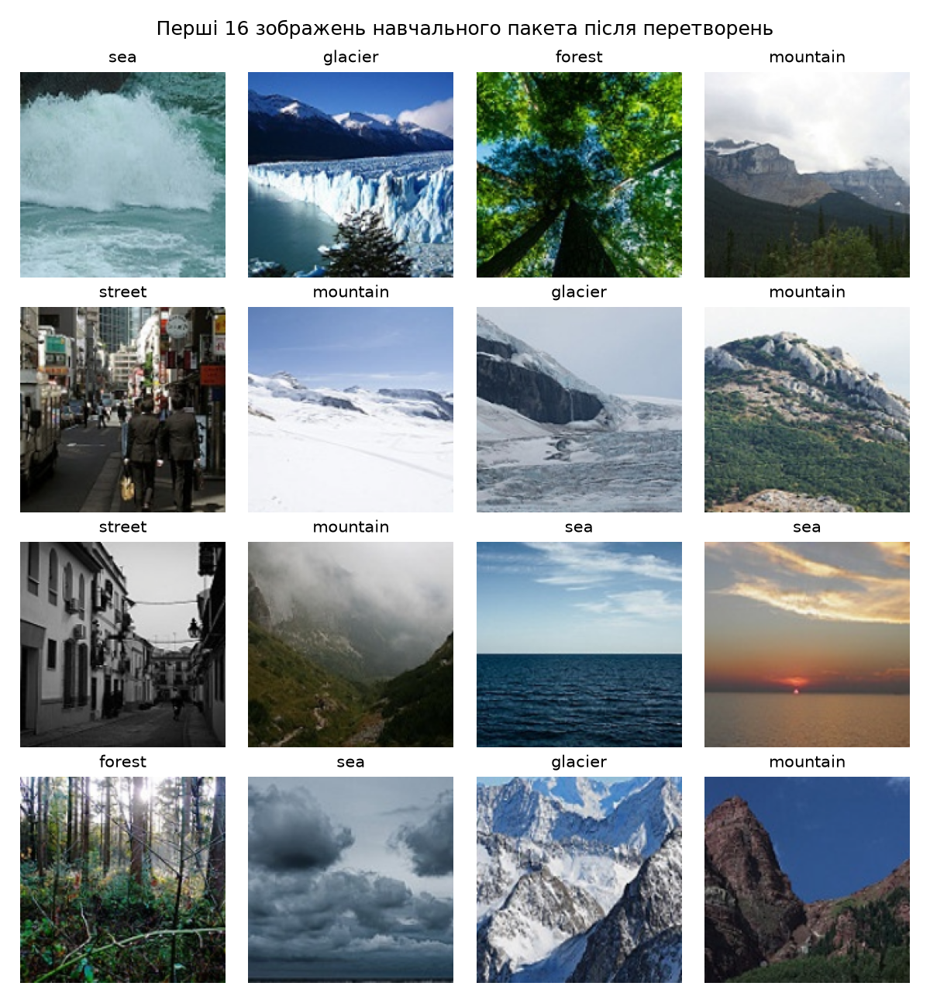
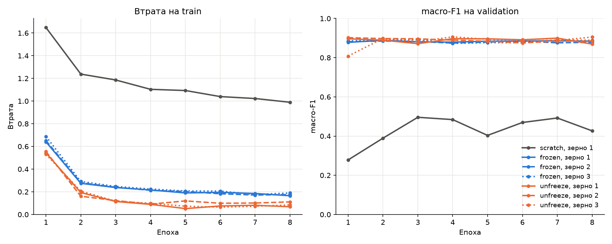
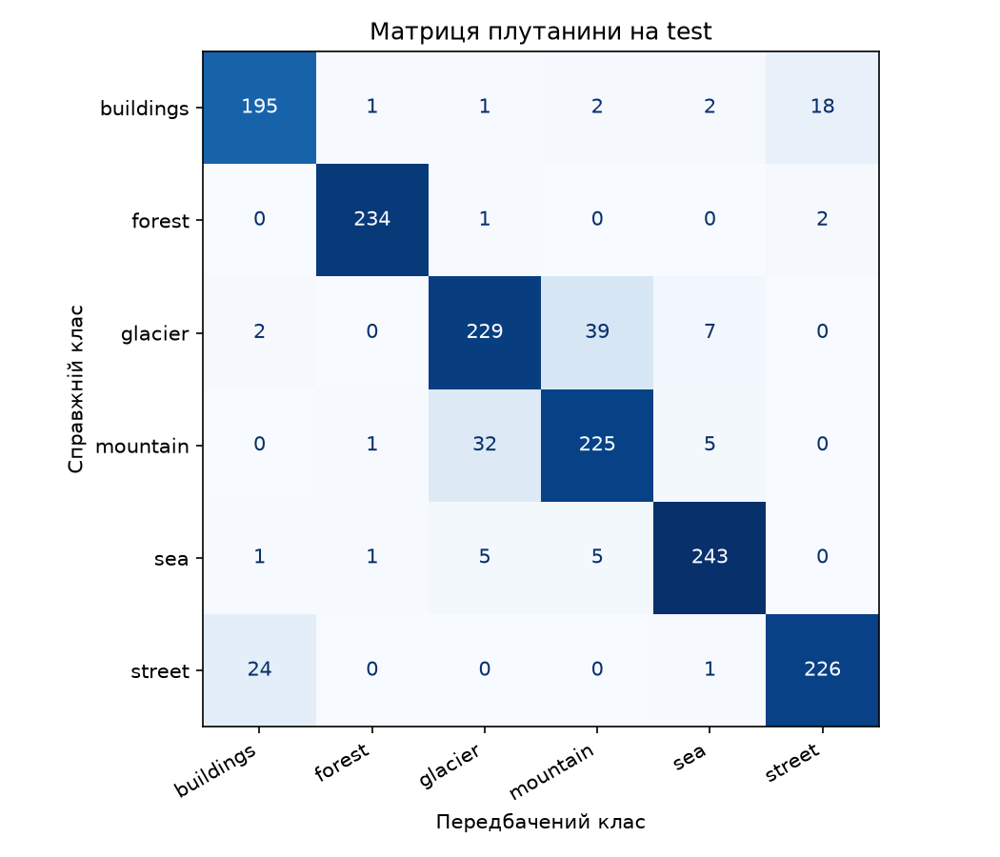
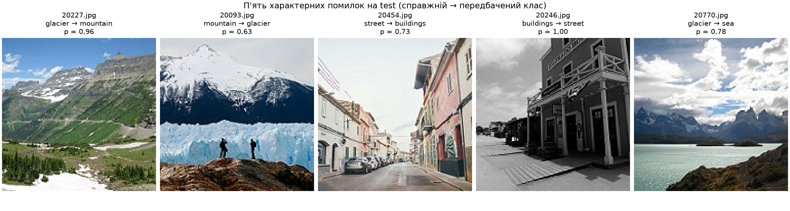

# Лабораторна робота №3

**на тему «Обчислювальний експеримент і трансферне навчання»**

з дисципліни «Системи глибинного навчання»

студентки групи КМ-31

Семеряги Софії

## Мета та зміст роботи

Метою роботи є порівняння трьох режимів навчання ResNet-18 на малій вибірці
за однакового обчислювального бюджету та відповідь на питання: яку частину
виграшу дають попередньо навчені ознаки, яку дає донавчання кістяка під нову
задачу, і чи більша кожна з цих різниць за розкид між запусками.

Режими відрізняються лише ініціалізацією і тим, що навчається: scratch
навчає всю мережу з випадкових ваг, frozen навчає лише нову голову поверх
кістяка з вагами ImageNet, unfreeze додатково донавчає останню стадію кістяка
`layer4` з удесятеро меншою швидкістю. Перед основним експериментом поділ,
пакет після перетворень, початкову втрату й поведінку кожного режиму
перевірено за контрольними числами умови. Конфігурацію обрано лише
за валідаційною вибіркою, а тестову вибірку використано один раз.

## Відтворення

Використано набір [Intel Image Classification](https://www.kaggle.com/datasets/puneet6060/intel-image-classification).
Набір до репозиторію не додано, шлях до теки, що містить `seg_train/`
і `seg_test/`, передається параметром `--data`. Нижче архів розпаковано
в теку `data/` усередині `lab3/`.

Команди виконуються з теки `lab3/`. Команда для запуску навчання:

```bash
uv run python train.py --data data --runs runs_rerun --model lab3_model_rerun.pt
```

Команда для запуску аналізу зі збережених журналів і тестової оцінки:

```bash
uv run python analyze.py --data data
```

Перша команда будує поділ і `split.csv`, виконує перевірки пунктів 1–2,
сім запусків, записує журнали й логіти validation, обирає конфігурацію
та зберігає її ваги. Тестову вибірку вона не завантажує. Тека `runs/`
і файл `lab3_model.pt` у репозиторії містять запуски, за якими складено звіт,
а команда навчання не записує результати в непорожню теку, тому повторне
навчання виконується в окрему теку та окремий файл моделі. Повторний запуск
можна проаналізувати командою
`uv run python analyze.py --data data --runs runs_rerun --model lab3_model_rerun.pt --out analysis_rerun`.

Друга команда перевіряє хеш `split.csv` у журналах, будує зі збережених
журналів таблицю, криві й розклад ефектів, перевіряє вибір конфігурації,
а потім один раз обчислює на CPU логіти test для `lab3_model.pt`, матрицю
плутанини та п'ять характерних помилок. Результати записуються в теку
`analysis/`.

Версії залежностей зафіксовані у `pyproject.toml` та `uv.lock`, версія
Python обмежена гілкою 3.12. Навчання виконано на MPS (Apple Silicon)
у `float32`, тестову оцінку — на CPU. Обчислення на MPS недетерміновані,
тому значення macro-F1 при повторному навчанні можуть відрізнятися.
Від фіксованих налаштувань умови відхилень немає.
Крім бібліотек зі стеку умови, для побудови поділу й таблиць використано
pandas, а зображення відкриваються функцією `torchvision.datasets.folder.pil_loader`,
яка виконує саме `Image.open(...).convert("RGB")`.

Усі сім журналів записано на коміті `d95e512` без незакомічених змін у файлах
коду й залежностей (`*.py`, `pyproject.toml`, `uv.lock`), саме їх перевіряє
позначка в журналі. Пізніші
коміти додали команду аналізу, друк таблиці параметрів у команді навчання
та звіт. Код поділу, моделі й циклу навчання після `d95e512` не змінювався.

## Структура проєкту

| Файл | Призначення |
|---|---|
| `data.py` | Поділ набору за процедурою умови, контрольна таблиця, набір даних за `split.csv`, перетворення та завантажувачі. |
| `model.py` | Побудова ResNet-18 для трьох режимів у порядку кроків 1–5 умови, групи оптимізатора AdamW, функція `set_train_mode` і перевірка кількості параметрів. |
| `checks.py` | Перевірки до навчання: рисунок пакета після перетворень, початкова втрата, перевірка того, що змінюється за 5 кроків, і дослід із навмисною помилкою. |
| `train.py` | Команда навчання: поділ, перевірки пунктів 1–2, сім запусків, журнали, вибір конфігурації та збереження `lab3_model.pt`. |
| `analyze.py` | Команда аналізу: перевірка хешу поділу, таблиця запусків і криві, розклад ефектів, перевірка вибору, тестова оцінка на CPU, матриця плутанини та п'ять помилок. |

| Тека або файл | Вміст |
|---|---|
| `split.csv` | Поділ на train, validation і test зі стовпцями `file`, `label`, `part`. |
| `runs/` | Для кожного з семи запусків журнал `run.json` і логіти validation після 8-ї епохи `val_logits.npy` (масив 1498 × 6 у порядку рядків `split.csv`). Ваги окремих запусків зберігалися локально й до репозиторію не додані. |
| `lab3_model.pt` | Ваги вибраного запуску (43 МБ) з ключами `state_dict`, `regime`, `seed`, `classes`, `img_size`. |
| `figures/` | Рисунок навчального пакета після перетворень `train_batch.png`. |
| `analysis/` | Таблиця запусків `runs_table.csv`, криві `curves.png`, ефекти `effects.json`, тестові метрики `test_metrics.json`, матриця плутанини `confusion_matrix.csv` і `confusion_matrix.png`, п'ять помилок `test_errors.csv` і `test_errors.png`. |

## 1. Дані та перевірки до навчання

### Поділ

Набір містить 14 034 зображення в `seg_train/seg_train` і 3 000 у
`seg_test/seg_test`, шість класів у фіксованому порядку buildings, forest,
glacier, mountain, sea, street (індекси 0–5). Тека `seg_pred` не
використовується.

Для кожного класу імена файлів відсортовано як рядки. Для навчальної вибірки
один генератор `np.random.default_rng(0)` використано для всіх класів
по черзі: для класу з $n_k$ файлами номери $0, \dots, n_k - 1$ перемішано,
і перші 200 номерів визначають файли train. Для validation і test створено
новий `np.random.default_rng(0)` і так само переставлено номери файлів
`seg_test`: перша половина, `idx[:n_k // 2]`, утворює validation, решта —
test.

Контроль поділу (у кожній клітинці кількість зображень і сума числових імен
файлів):

| Клас | train | validation | test | Збіг |
|---|---|---|---|---|
| buildings | 200 / 1 996 761 | 218 / 4 837 323 | 219 / 4 837 559 | так |
| forest | 200 / 2 032 625 | 237 / 5 276 962 | 237 / 5 291 326 | так |
| glacier | 200 / 2 183 923 | 276 / 6 135 652 | 277 / 6 157 250 | так |
| mountain | 200 / 1 950 345 | 262 / 5 789 535 | 263 / 5 849 765 | так |
| sea | 200 / 1 987 613 | 255 / 5 655 068 | 255 / 5 668 011 | так |
| street | 200 / 1 841 817 | 250 / 5 541 845 | 251 / 5 547 533 | так |
| Разом | 1200 / 11 993 084 | 1498 / 33 236 385 | 1502 / 33 351 444 | |

Усі 18 клітинок збігаються з контрольною таблицею умови. Повторів імен
у `split.csv` немає, тож жоден файл не входить у дві частини.

### Пакет після перетворень

Навчальні зображення проходять `RandomResizedCrop(160, scale=(0.7, 1.0))`,
`RandomHorizontalFlip()`, `ToTensor()` і `Normalize` зі статистиками ImageNet,
валідаційні й тестові — `Resize((160, 160))`, `ToTensor()` і те саме
нормування. Ті самі статистики ImageNet використано і в режимі scratch, щоб
режими відрізнялися лише ініціалізацією й тим, що навчається.



На рисунку перші 16 зображень навчального пакета в тому вигляді, в якому їх
отримує модель: після аугментацій, з оберненим нормуванням
$x \cdot \text{std} + \text{mean}$ і з назвою класу над кожним. Мітки
відповідають зображенням, кольори природні, кадри обрізано по-різному.

### Початкова втрата

Для режимів scratch і frozen модель побудовано зі зерном 1, після
`set_train_mode` під `torch.no_grad()` обчислено втрату на першому пакеті
до жодного кроку оптимізатора:

| Режим | $L_0$ | $L_0 - \ln 6$ | Стандартне відхилення логітів |
|---|---|---|---|
| scratch | 2,0479 | +0,2561 | 0,4882 |
| frozen | 1,9244 | +0,1326 | 0,6143 |

Обидва значення трохи вищі за $\ln 6 \approx 1{,}792$, втрату моделі, що дає
всім класам однакову ймовірність. Стандартна ініціалізація нового шару `fc`
дає не зовсім нульові логіти, і розподіл $q$ на виході softmax не є
рівномірним. На старті передбачення ще не пов'язані з мітками. Якщо мітка
не залежить від передбачення і всі шість класів рівноймовірні, математичне
сподівання втрати на прикладі з розподілом $q$ на виході дорівнює
перехресній ентропії рівномірного розподілу $u$ відносно $q$:

$$H(u, q) = \ln 6 + D_{KL}(u \,\|\, q) \ge \ln 6,$$

з рівністю лише для рівномірного $q$. Класи в пакеті представлені майже
порівну, тому середня втрата на пакеті близька до цього значення й лежить
вище за $\ln 6$. Відхилення невелике: втрата не вища
в кілька разів, що означало б надто великі логіти через ненормований вхід
або неправильний масштаб ініціалізації, і не нижча за $\ln 6$, що могло б
вказувати на потрапляння мітки у вхід. Різниця між режимами отримана
на одному пакеті з 32 зображень, тому окремого значення не має.

## 2. Перевірка режимів навчання

### Параметри

| Режим | Усього | Навчається | Групи AdamW (параметрів, швидкість навчання) | Збіг |
|---|---|---|---|---|
| scratch | 11 179 590 | 11 179 590 | 11 179 590 при $3 \cdot 10^{-3}$ | так |
| frozen | 11 179 590 | 3 078 | 3 078 при $3 \cdot 10^{-3}$ | так |
| unfreeze | 11 179 590 | 8 396 806 | 3 078 при $3 \cdot 10^{-3}$, 8 393 728 при $3 \cdot 10^{-4}$ | так |

Кількість параметрів — сума `numel()`. Числа збігаються з таблицею режимів:
голова `Linear(512, 6)` має $512 \cdot 6 + 6 = 3\,078$ параметрів, стадія
`layer4` — 8 393 728. В усіх режимах в оптимізатор потрапили рівно параметри
з `requires_grad=True`, жоден заморожений параметр до нього не переданий.
Оптимізатор — AdamW з `weight_decay=1e-4` в усіх групах, решта аргументів
за замовчуванням.

### Що змінюється під час навчання

Для режимів frozen і unfreeze збережено копію повного `state_dict()`
(параметри й буфери), викликано `set_train_mode` і виконано 5 кроків
оптимізатора на перших 5 пакетах. Порівняння — точне, через `torch.equal`.

| Режим | Модуль | Параметри змінилися | Ковзні статистики BN змінилися | Збігається з очікуваним |
|---|---|---|---|---|
| frozen | conv1 | ні | немає BN | так |
| frozen | bn1 | ні | ні | так |
| frozen | layer1 | ні | ні | так |
| frozen | layer2 | ні | ні | так |
| frozen | layer3 | ні | ні | так |
| frozen | layer4 | ні | ні | так |
| frozen | fc | так | немає BN | так |
| unfreeze | conv1 | ні | немає BN | так |
| unfreeze | bn1 | ні | ні | так |
| unfreeze | layer1 | ні | ні | так |
| unfreeze | layer2 | ні | ні | так |
| unfreeze | layer3 | ні | ні | так |
| unfreeze | layer4 | так | так | так |
| unfreeze | fc | так | немає BN | так |

Модулі, заморожені в режимі, не змінилися ні за параметрами, ні за
статистиками. У модулів, що навчаються, змінилися параметри, а в `layer4`,
що містить пакетну нормалізацію, — і ковзні статистики.

### Дослід із навмисною помилкою

#### Прогноз

Прогноз записано до запуску досліду.

Для режиму frozen функцію `set_train_mode` замінено на звичайний
`model.train()`. У замороженому кістяку параметри, тобто ваги згорток і
коефіцієнти γ, β пакетної нормалізації, не зміняться, бо їх немає в
оптимізаторі. Зміняться ковзні статистики `running_mean` і `running_var` у
всіх шарах пакетної нормалізації кістяка: у режимі `train()` вони
оновлюються під час прямого проходу за статистиками кожного пакета,
незалежно від `requires_grad`. Із кривої втрати на train цього не було б
видно, бо втрата спадає так само.

#### Результат

| Режим | Модуль | Параметри змінилися | Ковзні статистики BN змінилися | Збігається з очікуваним |
|---|---|---|---|---|
| frozen | conv1 | ні | немає BN | так |
| frozen | bn1 | ні | так | ні |
| frozen | layer1 | ні | так | ні |
| frozen | layer2 | ні | так | ні |
| frozen | layer3 | ні | так | ні |
| frozen | layer4 | ні | так | ні |
| frozen | fc | так | немає BN | так |

Максимальна абсолютна зміна в шарі `layer1.0.bn1` після 5 кроків:
`running_mean` — 0,0928, `running_var` — 0,1203.

Прогноз підтвердився: параметри кістяка не змінилися, а ковзні статистики
змінилися в усіх модулях, що містять пакетну нормалізацію. Уточнення до
останнього речення прогнозу: втрата на train і не могла показати цю зміну,
бо в режимі `train()` пакетна нормалізація нормує вхід за статистиками
поточного пакета, а ковзні статистики лише накопичуються й використовуються
тільки в режимі `eval()`, тобто на validation і test.

`requires_grad=False` не захищає ці значення, бо `running_mean` і `running_var`
є буферами, а не параметрами. Градієнт для них не обчислюється, оптимізатор
їх не оновлює, їх перезаписує сам шар під час прямого проходу в режимі
навчання:

$$\hat{\mu} \leftarrow (1 - m)\,\hat{\mu} + m\,\mu_B, \qquad m = 0{,}1.$$

Після 5 кроків від статистик ImageNet лишається частка $0{,}9^5 \approx 0{,}59$,
після повних 304 кроків — $0{,}9^{304} \approx 1{,}2 \cdot 10^{-14}$. Отже, кістяк
з незмінними вагами нормувався б повністю за статистиками пакетів цільової
вибірки, і ознаки, на яких навчено голову, на validation відрізнялися б від
ознак ImageNet.

Для `layer4` у режимі unfreeze оновлення статистик правильне. Ваги його
згорток навчаються, тому змінюються й середні та дисперсії їхніх виходів.
Пакетна нормалізація має нормувати ці виходи за статистиками, що відповідають
поточним вагам і цільовим даним, а статистики ImageNet описують уже інші
згортки.

## 3. Сім запусків

Кожен запуск будує модель у порядку кроків 1–5 умови: `torch.manual_seed(seed)`
і `np.random.seed(seed)`, ResNet-18 з вагами за режимом, нова голова
`Linear(512, 6)`, заморожування, перенесення на пристрій і створення
оптимізатора. Навчальний завантажувач має `batch_size=32`, `shuffle=True`
і `num_workers=0`, а перемішування бере випадковість із глобального
генератора PyTorch, засіяного на кроці 1. Бюджет становить 8 епох по 38
кроків, разом 304 кроки оптимізатора, останній пакет епохи містить 16
зображень. На початку кожної епохи викликається `set_train_mode`, після
кожної епохи обчислюються логіти validation і macro-F1. Розкладів
швидкості навчання, ранньої зупинки чи вибору епохи немає, використовуються
ваги після 8-ї епохи.

Журнал кожного запуску `runs/<режим>_seed<зерно>/run.json` містить зерно,
усі налаштування перетворень, моделі, оптимізатора й циклу навчання, включно
з тими, що лишилися за замовчуванням, хеш коміту й позначку незакомічених
змін, SHA-256 файлу `split.csv`, версії Python, PyTorch, torchvision, пристрій,
втрату на train і macro-F1 на validation за кожну епоху та час навчання.
В усіх семи журналах хеш поділу однаковий
(`148dad92de9a18670c177df9f8757aa6519fb0ea6d74a8ba723cfc4453f0a1bc`),
коміт `d95e512` без незакомічених змін, Python 3.12.14, PyTorch 2.14.1,
torchvision 0.29.2, пристрій `mps`.

| # | Режим | Зерно | Втрата train, епоха 8 | macro-F1 validation, епоха 8 | Час навчання, с |
|---|---|---|---|---|---|
| 1 | scratch | 1 | 0,9894 | 0,4266 | 127,2 |
| 2 | frozen | 1 | 0,1655 | 0,8842 | 39,3 |
| 3 | frozen | 2 | 0,1757 | 0,8785 | 34,7 |
| 4 | frozen | 3 | 0,1896 | 0,8886 | 33,6 |
| 5 | unfreeze | 1 | 0,0685 | 0,8692 | 47,2 |
| 6 | unfreeze | 2 | 0,1111 | 0,8855 | 46,8 |
| 7 | unfreeze | 3 | 0,0838 | 0,9050 | 46,8 |

Час навчання — сумарна тривалість навчальних фаз восьми епох без обчислення
validation.



Режим frozen дає macro-F1 близько 0,88, як орієнтир умови. Режими frozen
і unfreeze вже з другої епохи тримаються в межах 0,86–0,91, і їхні криві
на validation перетинаються. Крива scratch лежить значно нижче й коливається
між епохами.

## 4. Розклад ефектів

Для режимів frozen і unfreeze обчислено середнє й розмах за трьома зернами:

$$\bar{F}_r = \frac{1}{3} \sum_{s=1}^{3} F_{r,s}, \qquad R_r = \max_s F_{r,s} - \min_s F_{r,s}.$$

Поріг шуму — більший із двох розмахів, $R = \max(R_{\text{frozen}}, R_{\text{unfreeze}})$.
Ефект попереднього навчання та ефект розморожування:

$$\Delta_{\text{pre}} = \bar{F}_{\text{frozen}} - F_{\text{scratch},1}, \qquad \Delta_{\text{unf}} = \bar{F}_{\text{unfreeze}} - \bar{F}_{\text{frozen}}.$$

Їхня сума $\Delta_{\text{pre}} + \Delta_{\text{unf}} = \bar{F}_{\text{unfreeze}} - F_{\text{scratch},1}$
є повним виграшем трансферу відносно навчання з нуля.

| Величина | Значення |
|---|---|
| $\bar{F}_{\text{frozen}}$, $R_{\text{frozen}}$ | 0,8838, 0,0101 |
| $\bar{F}_{\text{unfreeze}}$, $R_{\text{unfreeze}}$ | 0,8866, 0,0358 |
| $R$ | 0,0358 |
| $\Delta_{\text{pre}}$ | +0,4571 |
| $\Delta_{\text{unf}}$ | +0,0028 |
| $\Delta_{\text{pre}} + \Delta_{\text{unf}}$ | +0,4599 |

Правило інтерпретації застосовано окремо до кожного ефекту. Для
$\Delta_{\text{pre}}$ маємо $|\Delta| > R$: ефект вартий перевірки, але
не доведений. Для $\Delta_{\text{unf}}$ маємо $|\Delta| \le R$: різниця
не відрізняється від розкиду, результату немає. Розмах трьох запусків
у середньому приблизно вдвічі більший за стандартну похибку різниці двох
середніх, тому правило вимагає помітного запасу над шумом, але сам розмах
за трьома значеннями неточний, і для ефекту, близького до $R$, вердикт
був би нестійким.

**Що змінює зерно.** У режимі scratch зерно визначає всі початкові ваги
мережі, порядок пакетів і параметри аугментацій. У режимах frozen
і unfreeze кістяк завжди стартує з тих самих ваг ImageNet, тому зерно
визначає лише початкову голову `fc`, порядок пакетів і аугментації.
У frozen кістяк не змінюється і для зображення після аугментації дає
ті самі ознаки, тож навчання зводиться до лінійного класифікатора на 512
фіксованих ознаках. Ця задача опукла за параметрами голови, різні зерна
приводять до близьких розв'язків, і розкид малий: $R_{\text{frozen}} = 0{,}0101$.
У unfreeze разом із головою навчаються 8,4 млн параметрів `layer4`, і їхня
траєкторія залежить від порядку пакетів і аугментацій. Більша свобода дає
більш різні розв'язки й більші коливання між епохами: у запуску з зерном 1
macro-F1 упав з 0,8996 на 7-й епосі до 0,8692 на 8-й, у запуску з зерном 3
перша епоха дала 0,8081. Тому $R_{\text{unfreeze}} = 0{,}0358$, у 3,5 раза
більше за $R_{\text{frozen}}$.

**Чому $R$ не характеризує запуск 1.** $R$ виміряно на запусках 2–7, у яких
кістяк стартує з однакових ваг, а випадковість стосується лише голови,
порядку пакетів і аугментацій. У scratch зерно визначає всю мережу, тож
джерело шуму інше, і за одним запуском його розкид оцінити неможливо.
Крива запуску 1 вказує, що цей шум, імовірно, більший за $R$: з 3-ї по 8-му
епоху macro-F1 коливається від 0,4035 до 0,4959, тобто на 0,09, а між
сусідніми епохами змінюється до 0,08, тоді як $R = 0{,}0358$. Отже, значення
$F_{\text{scratch},1} = 0{,}4266$ ненадійне саме по собі: інше зерно чи інша
епоха могли б дати число, яке відрізняється на кілька сотих. Висновку щодо $\Delta_{\text{pre}}$ це
не змінює: $\Delta_{\text{pre}} = 0{,}4571$ приблизно в п'ять разів більше
за ці коливання, і навіть найвище значення кривої scratch 0,4959 відстає
від $\bar{F}_{\text{frozen}}$ на 0,39.

**Чи однаковий бюджет за часом.** Ні. Усі режими виконали однакову кількість
кроків, 304, але час навчання різний: scratch — 127,2 с, frozen — 33,6–39,3 с,
unfreeze — 46,8–47,2 с. У scratch зворотний прохід іде через усю мережу
й оновлюються всі 11,2 млн параметрів. У frozen параметри кістяка не
потребують градієнта, тому зворотний прохід обмежується головою, і час
визначають головно завантаження зображень і прямий прохід. У unfreeze
зворотний прохід додатково проходить через `layer4`, яка працює на малій
карті $5 \times 5$, тому додає лише близько 10 с. Отже, однаковий бюджет
означає однакову кількість кроків, а не однаковий час: frozen досягає того
самого результату, що й unfreeze, приблизно на чверть швидше.

## 5. Вибір конфігурації і тестова оцінка

Вибір виконано в команді навчання лише за validation: обрано режим
із найбільшим $\bar{F}_r$, а в ньому запуск із найбільшим $F_{r,s}$.
Найбільше середнє має unfreeze (0,8866 проти 0,8838 у frozen і 0,4266
у scratch), найкращий запуск у ньому — зерно 3 з $F = 0{,}9050$. Його ваги
збережено в `lab3_model.pt` з `regime="unfreeze"`, `seed=3`, класами
в фіксованому порядку та `img_size=160`.

Оскільки $|\Delta_{\text{unf}}| \le R$, вибір між frozen і unfreeze визначив
шум. Процедура від цього не змінюється, проте за цими числами режими
frozen і unfreeze рівноцінні.

Команда аналізу перевіряє вибір за збереженими журналами: правило дає
unfreeze, зерно 3, що збігається з `lab3_model.pt`. Додатково логіти
validation, обчислені для `lab3_model.pt` на CPU, порівняно з логітами,
збереженими в журналі під час навчання на MPS: найбільша різниця
$7{,}6 \cdot 10^{-5}$, передбачення збігаються на всіх 1498 зображеннях.
Отже, у файлі справді ваги вибраного запуску.

### Тестова оцінка

Тестову вибірку (1502 зображення) використано один раз, у команді аналізу,
на CPU.

| Величина | Значення |
|---|---|
| macro-F1 на test | 0,9019 |
| $F_{r,s}$ вибраного запуску на validation | 0,9050 |
| Різниця test − validation | −0,0031 |
| accuracy на test $p$ | 0,9001 |
| $\sqrt{p(1 - p)/n}$, $n = 1502$ | 0,0077 |

Матриця плутанини (рядки — справжній клас, стовпці — передбачений):

| Справжній \ передбачений | buildings | forest | glacier | mountain | sea | street |
|---|---|---|---|---|---|---|
| buildings | **195** | 1 | 1 | 2 | 2 | 18 |
| forest | 0 | **234** | 1 | 0 | 0 | 2 |
| glacier | 2 | 0 | **229** | 39 | 7 | 0 |
| mountain | 0 | 1 | 32 | **225** | 5 | 0 |
| sea | 1 | 1 | 5 | 5 | **243** | 0 |
| street | 24 | 0 | 0 | 0 | 1 | **226** |



З 1502 тестових зображень помилково класифіковано 150. З них 71 припадає
на пару glacier ↔ mountain (39 і 32) і 42 — на пару street ↔ buildings
(24 і 18), разом 75 % усіх помилок. Ліс майже ні з чим не плутається.

**Зміщення від вибору.** Вибір найкращого з трьох запусків робить його
валідаційне число оптимістичним: $F = 0{,}9050$ вище за середнє режиму
0,8866 на 0,018, і частина цієї переваги може бути пристосуванням
до конкретних зображень validation. У наших числах зміщення не видно:
macro-F1 на test нижчий лише на 0,0031, що менше за стандартну похибку
частки правильних відповідей $\sqrt{0{,}9001 \cdot 0{,}0999 / 1502} \approx 0{,}0077$.
Validation і test — дві різні половини `seg_test`, і кожна оцінка має власний
шум порядку 0,008, тож різниця двох таких оцінок має шум порядку
$0{,}008 \cdot \sqrt{2} \approx 0{,}011$. Зміщення того самого порядку
або менше може бути непомітним, а випадкова перевага тестової половини
може навіть дати різниці протилежний знак.

### П'ять характерних помилок

Узято п'ять найчастіших позадіагональних пар матриці плутанини (за однакової
кількості — у порядку зростання індексу справжнього, потім передбаченого
класу) і для кожної пари перший за іменем файл test із такою помилкою.
Імовірність — значення softmax логітів test для передбаченого класу.

| Файл | Справжній клас | Передбачений клас | Імовірність передбаченого класу | Кількість таких помилок у test |
|---|---|---|---|---|
| 20227.jpg | glacier | mountain | 0,9564 | 39 |
| 20093.jpg | mountain | glacier | 0,6273 | 32 |
| 20454.jpg | street | buildings | 0,7307 | 24 |
| 20246.jpg | buildings | street | 1,0000 | 18 |
| 20770.jpg | glacier | sea | 0,7819 | 7 |



Усі п'ять помилок належать до категорії «сцена містить обидва класи»:

- **20227.jpg** (glacier → mountain): схоже на льодовиковий ландшафт, у якому
  лід і сніжники займають малу частину кадру, а переважає гірська долина.
- **20093.jpg** (mountain → glacier): засніжена вершина й стіна льодовика
  на передньому плані однаково помітні, і модель вагалася між ними
  (імовірність 0,63).
- **20454.jpg** (street → buildings): вулиця між рядами фасадів, які займають
  більшу частину кадру.
- **20246.jpg** (buildings → street): фасад будівлі разом із тротуаром
  і вулицею вздовж нього.
- **20770.jpg** (glacier → sea): велике озеро на першому плані, а гори,
  на яких схоже є льодовики, лише на горизонті.

Плутанина glacier ↔ mountain є властивістю набору: на багатьох знімках є
і гора, і лід, і мітка залежить від того, що анотатор вважав головним.
Імовірно, її посилює й схожість самих об'єктів для згорткових ознак:
льодовик і засніжений хребет мають зубчасті вершини, різкі межі світлого
й темного та біло-блакитну гаму, тож у просторі ознак кістяка вони
лежать близько. Які саме ознаки використала модель, окремо
не перевірялося, тому це гіпотеза.

На трьох знімках із п'яти (20227, 20454, 20770) модель назвала клас
об'єкта, що займає найбільшу частину кадру, тоді як мітка відповідає
меншому об'єкту. Проте це не правило: на 20246 будинок займає більшу частину
кадру, а модель упевнено відповіла street. Крім того, 20454 і 20246 мають
схожу композицію, фасади вздовж вулиці, а помилки на них протилежні.
Ймовірно, межа між класами street і buildings у наборі нечітка: на більшості
таких знімків є і будинки, і вулиця. П'яти прикладів недостатньо, щоб
підтвердити будь-яке з цих спостережень, тому вони залишаються гіпотезами.

## Висновки

У ході виконання лабораторної роботи №3 реалізовано поділ набору Intel Image
Classification за процедурою умови й перевірено його за контрольною
таблицею, побудовано ResNet-18 у трьох режимах навчання, перевірено кількість
параметрів, склад груп оптимізатора та поведінку кожного модуля під час
навчання, а дослідом із навмисною помилкою показано, що `requires_grad=False`
не захищає ковзні статистики пакетної нормалізації. Виконано сім запусків
за однакового бюджету в 304 кроки з журналами, обчислено розклад ефектів,
за validation обрано конфігурацію unfreeze із зерном 3 і один раз оцінено
її на test: macro-F1 становить 0,9019.

За результатами роботи можна зробити такі висновки.

Попереднє навчання дає великий додатний ефект. Режим frozen має
$\bar{F}_{\text{frozen}} = 0{,}8838$ проти $F_{\text{scratch},1} = 0{,}4266$,
тобто $\Delta_{\text{pre}} = +0{,}4571$, або 45,7 пункта macro-F1. Це приблизно
в 13 разів більше за поріг шуму $R = 0{,}0358$, тому за правилом роботи ефект
вартий перевірки, хоча й не доведений. Ефект виміряно за бюджету в 304 кроки:
втрата scratch на train до 8-ї епохи ще спадала (з 1,6485 до 0,9894),
тож із довшим навчанням scratch міг би скоротити відставання.

Розморожування останньої стадії кістяка результату не дало. Режим unfreeze
має $\bar{F}_{\text{unfreeze}} = 0{,}8866$, тобто $\Delta_{\text{unf}} = +0{,}0028$,
або 0,3 пункта macro-F1, що в 13 разів менше за $R = 0{,}0358$. Різниця між
frozen і unfreeze не відрізняється від розкиду між зернами, і вибір
конфігурації unfreeze за validation визначив шум. Майже весь повний виграш
трансферу $\Delta_{\text{pre}} + \Delta_{\text{unf}} = +0{,}4599$ дають
попередньо навчені ознаки. Ефект розморожування також виміряно за бюджету
в 304 кроки.

Для нової задачі з 200 зображеннями на клас я взяла б режим frozen: за тієї
самої якості в межах шуму він дає у 3,5 раза менший розкид між зернами
(0,0101 проти 0,0358) і навчається приблизно на чверть швидше за unfreeze
(близько 35 с проти 47 с).

## Використані джерела

Під час оформлення звіту використано генеративний інструмент Claude Opus 5.5
(Anthropic). Висновки сформульовано авторкою, а Claude оформлював їх
і решту тексту звіту.
